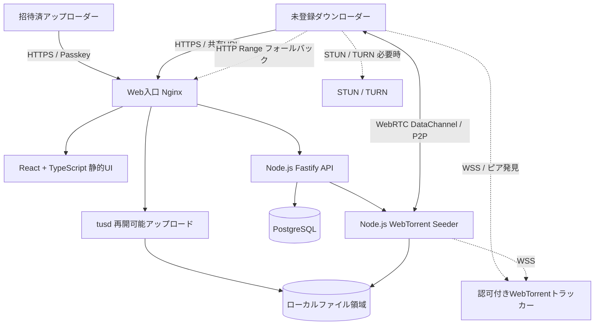

# コスプレ写真共有サービス システム仕様書

- 文書バージョン：1.0（基本設計案）
- 作成日：2026-10-21
- 対象：仲間内の大容量コスプレ写真共有
- ステータス：実装前レビュー用

## 1. 目的と設計原則

ギガファイル便に代わり、撮影者が写真をアップロードして共有URLを配布し、受信者が送信者オフライン時にも100GB超の写真を取得できるWebサービスを提供する。

1. アップロード権限は管理者からの完全招待制とする。
2. ログイン方法はパスキー（WebAuthn）に限定する。パスワード・メールOTP・SNSログインは設けない。
3. ダウンロード者はアカウント登録・ログイン不要とする。「利用制限なし」は利用者資格や回数の制限を設けない意味とし、不正アクセス・DoS・自動収集防止のレート制御は実施する。
4. 既知のAIクローラー・AIエージェントのアクセスを禁止し、技術的遮断と利用規約を併用する。ただし公開URLを持つ任意のクライアントからのアクセスを許す以上、AIや自動化クライアントを完全識別・遮断することは技術的に保証できない。
5. 常時稼働する自宅サーバを完全シードとして使用し、ブラウザとのWebRTC P2P転送を主経路とする。
6. 端末・NAT条件によってP2Pが成立しない場合は、中継またはHTTPフォールバックを使う。100GB超の転送で費用が増えるTURN・HTTP中継は制御・計測する。
7. Proxmox VE上の単一Linux VMにコンテナなしで直接構築する。サービス管理はsystemdを使用する。

## 2. スコープ

### 2.1 初期リリースに含める

- 管理者による招待の発行・失効
- 招待を受けたアップローダーのパスキー登録・認証・デバイス追加・失効
- 100GB以上を想定した中断再開可能なアップロード
- 写真セット作成、複数ファイル格納、メタデータ管理、共有URL発行、公開停止、有効期限
- ログイン不要のファイル一覧・プレビュー・ダウンロード
- Node.js版WebTorrentシードとブラウザ版WebTorrentを利用するP2P配布
- ICE/STUNによるCGNAT越え、接続失敗時のフォールバック
- AIクローラー対策、Web APIの悪用抑止、監査ログ、自動削除
- サーバ側のハッシュ検証・ファイル完了状態管理

### 2.2 初期リリースでは対象外

- 不特定ユーザーの自主登録および公開アップロード
- パスワードログイン、SNSログイン、メールログイン
- AI画像解析・自動タグ付け・AI検索
- 不特定ピア向けの公開Torrent配布
- モバイルブラウザにおける100GBのP2P保存成功保証
- 匿名の第三者ピアによる無条件の再配布（後続フェーズで検討）
- データ全量のゼロ知識暗号化（後続フェーズで検討）

## 3. 想定規模と非機能要件

|項目|初期設計値|
|---|---|
|アップローダー|数人〜数十人、招待制|
|受信者|1共有につき概ね2〜10人|
|1共有の合計容量|最大200GB（設定値で変更可能）|
|単一ファイル|最大200GB（ファイルシステム・ライブラリで検証）|
|同時アップロード|初期2件、設定変更可能|
|同時受信|初期10接続、運用に合わせ調整|
|保持期限|標準7日、管理者設定で変更可|
|保存容量|初期2TB推奨（予約・部分アップロード込みで管理）|
|整合性|完成ファイルのサイズ・SHA-256照合、Torrentピース検証|
|可用性|単一VM運用。VM・回線停止中はサービス利用不可|
|ブラウザ|最新のChromium系、Firefox、Safariを機能ごとに試験|

数値は仮の初期設定であり、本番投入前のベンチマークにより確定する。

## 4. 利用者と権限

|役割|認証|権限|
|---|---|---|
|管理者|パスキー必須|招待発行、ユーザー停止、共有管理、システム設定、監査閲覧|
|アップローダー|招待後のパスキー必須|自分のセット作成、アップロード、公開・停止、期限設定、削除|
|ダウンローダー|不要|共有URLに対応する公開中ファイルの参照・取得|

- ダウンローダーに会員登録・パスキー登録は要求しない。
- 公開ディレクトリ・検索エンジン用サイトマップ・ファイル一覧の横断検索は提供しない。
- URLを知る人は取得可能とする。URLの第三者転送を技術的に完全には防げない。

## 5. 論理アーキテクチャ



### 5.1 構成要素

|区分|技術|責務|
|---|---|---|
|フロントエンド|React / TypeScript / Vite|アップロード、一覧、ダウンロードUI|
|バックエンド|Node.js LTS / Fastify|WebAuthn、権限、メタデータ、共有管理、API|
|P2Pシード|WebTorrent（Node.js）|完成済み写真セットのTorrent生成・保持・配布|
|トラッカー|WSS対応のプライベートトラッカー|公開範囲内のピア発見・認可|
|アップロード|tusd（systemd独立起動）|resumable upload、部分ファイル管理|
|Web入口|Nginx|TLS、APIリバースプロキシ、静的配信、Rangeダウンロード|
|DB|PostgreSQL|ユーザー、認証器、招待、写真セット、監査|
|保存|VMの専用マウント領域|元画像、Torrent情報、プレビュー、一時領域|
|運用|systemd / journal / logrotate|起動、再起動、ログ、ヘルスチェック|

WebTorrentは初期段階ではサーバシード→ブラウザ受信を必須とする。ブラウザ受信者間の再配布は、ブラウザの動作継続・プライバシー・ピア認可が検証できた後にオプションとして有効化する。

**実装上の確認事項：** Node.js版WebTorrentとブラウザ版間のWebRTC対応、シード初期化、必要なネイティブ依存関係、WSSトラッカー相互運用性を、採用バージョンで必ずPoC検証する。Torrentの通常の公開DHTや公開トラッカーは使わない。

## 6. ネットワーク仕様

### 6.1 公開経路

- Web UI・API・トラッカー制御：HTTPS/WSS。Cloudflare等の入口側でボット防御を実施できる構成。
- 大容量データ：WebRTCピア間通信を優先。CGNAT下でもICE/STUNにより直接接続を試みる。
- WebRTC直接接続が不成立の場合：TURNの使用可否を判定し、費用上限を超える場合は明示的にHTTPフォールバックを提示。
- HTTPフォールバック：IPv6直結または別途用意したIPv4到達可能なHTTPS配信経路。IPv4専用利用者にIPv6直結を提示しない。
- Cloudflare Tunnel / 一般のHTTPプロキシは制御系に使う。WebRTC UDPのデータ転送がTunnelを自動通過するとは扱わない。
- オリジンのTLS証明書、IPv4/IPv6到達性、ルーター・FWの許可ポートは配備時に確定する。

### 6.2 TURNポリシー

- 初期値ではTURN経由の大容量転送を無制限に許容しない。
- ICEで `host` または `srflx` 候補による直接経路を優先する。
- TURN使用時は接続別転送量・接続時間・費用を監視し、上限に基づき代替方式に切り替える。
- TURNを必須とするネットワーク利用者向けに、運用上の制約をUIで表示する。

## 7. アカウント・招待・パスキー仕様

### 7.1 招待登録

1. 管理者が招待対象者を指定し、権限・有効期限を設定する。
2. サーバが推測困難な単回使用招待トークンを発行する（DBには原則ハッシュのみ保存）。
3. 招待リンクを私的な経路で対象者に伝える。
4. 利用者は招待リンクを開き、表示名など必要最小限のプロフィールを入力する。
5. WebAuthn登録チャレンジを発行する。招待トークンは登録完了時まで有効かつ単回使用とする。
6. パスキーの登録・検証に成功したら招待を使用済みにし、アップローダーアカウントを有効化する。
7. 招待失効、再利用、登録試行回数超過は拒否する。

### 7.2 認証ポリシー

- `@simplewebauthn/server` と `@simplewebauthn/browser` を使用する。
- WebAuthn `rpID` と `origin` を固定し、サーバ側で検証する。
- 登録時は `residentKey: required`、ログイン時はユーザー検証（UV）を **required として検証** する。
- パスキーの公開鍵・credential ID・counter・transports・バックアップ属性など、必要な検証情報のみ保存し、秘密鍵・生体情報は保存しない。
- 認証成功後は短寿命のHttpOnly / Secure / SameSite Cookieによるセッションを発行。認証そのものは毎回パスキーとする。
- CSRF対策、セッション固定化対策、ログアウト時失効を実施する。
- パスワード、メールOTP、SMS、ソーシャルログイン、マジックリンクによるログインは実装しない。
- メールアドレスは任意の連絡先として保持可能だが、認証手段には使用しない。

### 7.3 パスキー紛失時の復旧

- ユーザー自身によるメールだけの復旧を禁止する。
- 既存の有効パスキーでログイン中の端末から追加登録できる。
- 全パスキー紛失時は管理者が本人確認を行い、既存セッション・資格情報を停止し、**新規の単回使用再招待**を発行する。
- 再招待によりパスキーの再登録は可能だが、「ログイン方法」は常にパスキーに限定する。
- 初期管理者はVMコンソールからの管理コマンドによる安全なブートストラップで作成する。公開登録APIは持たない。

## 8. 写真セット・共有仕様

- 1共有は `album`（写真セット）として管理し、複数の画像・RAW・ZIP等をまとめられる。
- 写真セットIDは内部UUID、共有URLは独立した高エントロピートークンを使用する。
- トークンはDBでハッシュ化し、期限・状態・写真セットIDに対応付ける。
- 共有ページおよびAPIではファイルの実パスやストレージ構造を露出しない。
- `draft → uploading → processing → published → expired / revoked → deleted` の状態を持つ。
- 処理完了前のセットは第三者へ公開しない。
- 元画像は改変しない。プレビュー用の縮小画像のみ別途生成する。
- プレビューのEXIF/位置情報は除去する。元ファイルにはEXIFが残ることをアップローダーに明示する。
- 共有URLをSNS等に貼り付けた場合の外部プレビュー取得を抑制するため、`Referrer-Policy: no-referrer`、`noindex,nofollow`、OGタグ非掲載を基本とする。
- 利用者が元ファイル名を含むファイルを再配布することは防止できない。

## 9. アップロード設計

1. 認証済アップローダーがセットを作成する。
2. APIが容量割当、期限、ユーザー権限を確認する。
3. APIが短寿命・セット限定のアップロード権限を発行する。
4. フロントは `tus-js-client` 等で分割・再開可能なHTTPSアップロードを行う。
5. tusdはアップロード認可をAPIのフック等で検証し、一時領域に書き込む。tusdを無認証で公開しない。
6. 完了時にサイズ・ハッシュ・ファイル数・許容拡張子等を検証する。
7. 検証後に一時領域から正式領域へ安全に確定し、Torrentメタデータを生成する。
8. 常時シードを開始し、シード状態を確認してからセットの公開を許可する。

### 9.1 データ整合性

- アップロード中断後の再開位置はサーバを正として扱う。
- ファイルサイズ・SHA-256・空き容量・保存権限を検証する。
- アップロード完了イベントを二重受信しても安全な冪等処理とする。
- 一時ファイルおよび失効した部分アップロードは定期清掃する。
- 再試行による二重容量計上を防ぐ。

## 10. ダウンロード・P2P仕様

### 10.1 ブラウザ受信

1. ダウンローダーは共有URLを開き、認証なしで公開状態と期限が検査される。
2. ファイル一覧・サムネイル・合計容量を表示する。
3. ダウンロード開始時にAPIから短寿命のピア参加トークンとTorrentの取得情報を受け取る。
4. 認可付きWSSトラッカーから許可されたピアだけを発見する。
5. ブラウザ版WebTorrentがNode.jsシードノードへWebRTC接続を試みる。
6. 接続成立時はピースごとに取得し、WebTorrent側で整合性を確認する。
7. 直接接続が一定時間成立しない場合、TURNまたはHTTP Rangeへの切替を提示する。
8. ダウンロード完了後はサイズ・ハッシュ確認を行う。必要なら再取得可能とする。

### 10.2 100GB超への対応

- 100GB全体をJavaScriptメモリに保持しない。
- `Blob` の全量生成や、完成後に一括メモリコピーする設計を禁止する。
- 保存先への逐次書き込み・チャンク保持・再開メタデータを設計する。
- File System Access API等はブラウザ互換性を検証し、非対応ブラウザにはHTTP Range対応の通常ダウンロードを提供する。
- `ZIPまとめダウンロード` は、サーバに新たな200GB級ファイルを無制限に生成しない。初期段階は個別ファイル・事前アップロードZIPを基本とする。
- ブラウザ版WebTorrentでの長時間転送、メモリ使用量、保存先、再起動後のピース再利用可否はPoCの**出荷判定項目**とする。

### 10.3 プライベートスウォーム

- 公開DHT、公開トラッカー、無制限PEXに依存しない。
- 共有ごとにピア参加権限を設定し、期限切れ・失効後は新規ピア紹介を止める。
- **トラッカー認可だけでは、既知のTorrent情報を持つピアのデータ取得を完全には止められない**。既存接続の遮断、サーバ側のシード停止、再配布ピア制御を実装する。
- ダウンローダー同士の再配布を初期無効とする。将来有効化時は同意、IPアドレス露出、公開停止後の取り扱いを明示する。
- ファイルの有効期限・共有停止は、ダウンロード済コピーや外部で再配布されたデータには適用できない。

## 11. AIアクセス禁止仕様

### 11.1 禁止対象

- モデル学習、検索用収集、生成AI用RAG収集、AIエージェントによる自動閲覧・取得・解析を目的とするアクセス。
- 明示的に許可していないクローラー、スクレイパー、自動収集ツールによる取得。
- ダウンロードした画像のAI学習への利用は利用規約で禁止する。ただし取得後の利用を技術的に完全制御することはできない。

### 11.2 技術対策（多層）

1. Cloudflare等の入口で `Block AI bots` の **Training / Search / Agent をすべてBlock** に設定する（利用機能・プランの提供範囲を確認）。
2. `robots.txt` で全面Disallowし、主要AI User-Agentの拒否方針を示す。ただしrobots.txt単体に強制力はない。
3. アプリ層でも既知のAI User-Agent、異常な大量アクセス、共有トークン総当たり、過剰なメタデータ収集を検出・拒否する。
4. AIボット対策は、共有ページだけでなくAPI・サムネイル・HTTPファイル配信にも適用する。CDN経由でないIPv6直結入口にはNginxとアプリ側で代替制御する。
5. `noindex, nofollow, noarchive, noimageindex` 等のメタ指定、サイトマップ無効化、ディレクトリ一覧禁止、推測不能URLを採用する。
6. 共有リンクを持たないアクセスにはファイル名・一覧・Torrentメタデータを開示しない。
7. 自動アクセス対策のレート制限は許容するが、通常の匿名ダウンロード者にログイン・招待を強制しない。
8. ブロック誤判定、ユーザーエージェント偽装、プロキシ経由、自作クライアントを想定した監査・運用手順を整える。

**限界（必須明記）：** 人間のブラウザを模倣するボット、AIサービスからの代理アクセス、URLを受け取った第三者、WebRTC P2Pのトラフィックは、HTTP入口のWAFだけでは完全遮断できない。公開ダウンロードと『AIアクセスの絶対禁止保証』は両立しない。システム目標は『識別可能なAIアクセスを拒否し、無許可の収集を困難にする』ことと定義する。

### 11.3 利用規約・掲載事項

- AIによる自動収集・解析・学習・再配布を禁止する文言を掲載する。
- アップローダーに写真の権利・被写体の共有同意の確認を求める。
- 削除請求・通報・運営者への連絡手段を設ける。

## 12. API仕様（概要）

|Method|Path|認証|用途|
|---|---|---|---|
|POST|`/api/admin/invitations`|管理者パスキーセッション|招待発行|
|POST|`/api/auth/register/options`|有効招待|WebAuthn登録オプション|
|POST|`/api/auth/register/verify`|有効招待|登録検証と有効化|
|POST|`/api/auth/login/options`|不要|WebAuthn認証オプション|
|POST|`/api/auth/login/verify`|WebAuthn応答|検証とセッション発行|
|POST|`/api/auth/logout`|ログイン済|セッション失効|
|GET|`/api/me`|ログイン済|アカウント情報|
|POST|`/api/albums`|アップローダー|セット作成|
|POST|`/api/albums/{id}/upload-authorizations`|所有者|tusアップロード許可|
|POST|`/api/albums/{id}/publish`|所有者|検証済セットを公開|
|POST|`/api/albums/{id}/revoke`|所有者|公開停止|
|GET|`/api/s/{shareToken}`|不要・有効URL必須|公開セットの表示情報|
|POST|`/api/s/{shareToken}/peer-session`|不要・有効URL必須|期限付きピア参加情報|
|GET|`/api/s/{shareToken}/files/{fileId}`|不要・有効URL必須|HTTP Range配布|
|GET|`/health/live`|内部監視|プロセス生存確認|
|GET|`/health/ready`|内部監視|DB・シード・保存状態確認|

- 全APIのリクエストスキーマ・エラー応答・レート制限はOpenAPIで定義する。
- 招待トークン・共有トークン・ピア参加トークンをアクセスログに平文記録しない。
- パスキー登録・認証チャレンジは短寿命・単回使用とする。

## 13. データモデル（概要）

|テーブル|主要カラム|
|---|---|
|users|id, display_name, role, status, created_at|
|passkey_credentials|id, user_id, credential_id, public_key, counter, transports, backup_state, created_at|
|invitations|id, token_hash, role, expires_at, used_at, revoked_at, created_by|
|sessions|id, user_id, expires_at, revoked_at, last_seen_at|
|albums|id, owner_id, title, status, total_bytes, expires_at, created_at|
|files|id, album_id, original_name, stored_name, size_bytes, sha256, mime_type, state|
|share_links|id, album_id, token_hash, expires_at, revoked_at|
|torrent_swarms|id, album_id, info_hash, torrent_manifest_path, seed_status, last_announced_at|
|upload_jobs|id, album_id, file_id, tus_upload_id, expected_bytes, received_bytes, state|
|download_events|id, album_id, pathway, bytes_sent, client_fingerprint_hash, created_at|
|audit_logs|id, actor_id, action, target_type, target_id, timestamp, result|

IPなどの情報は必要最小限かつ短期保持とする。認証情報・共有トークン・本人を識別可能な監査情報はアクセス権を分離する。

## 14. VM・ファイル配置・運用

### 14.1 VM案（初期値）

|リソース|推奨初期値|
|---|---|
|OS|Debian 13 x86_64|
|vCPU|4 vCPU|
|メモリ|8GB（大容量シードPoCで確認）|
|OSディスク|64GB|
|データディスク|2TB以上、OSディスクから分離|
|IP|管理用アドレス、外部公開用の到達経路を分離|
|仮想化|Proxmox VE VM、Docker/LXC非使用|

### 14.2 ディレクトリ案

```text
/opt/cosshare/           # アプリ配置（git等でデプロイ）
/etc/cosshare/           # 環境変数・秘密情報（root権限）
/srv/cosshare/uploads/   # tus部分アップロード
/srv/cosshare/files/     # 完成ファイル
/srv/cosshare/torrents/  # Torrentメタデータ
/srv/cosshare/previews/  # サムネイル
/var/log/cosshare/       # アプリ監査ログ（ローテーション）
```

### 14.3 systemdサービス

- `cosshare-api.service`：Fastify API
- `cosshare-seeder.service`：WebTorrentシード
- `cosshare-tracker.service`：WSSトラッカー
- `tusd.service`：再開可能アップロード
- `postgresql.service`：メタデータDB
- `nginx.service`：TLS/配信
- `cosshare-cleanup.timer`：期限切れ清掃
- `cosshare-health.timer`：整合性・ヘルス監視（必要に応じて）

専用OSユーザーで起動し、各サービスの読書権限・マウントアクセス・ネットワーク権限を最小化する。`systemd` の `ProtectSystem`、`NoNewPrivileges` 等を評価する。

### 14.4 バックアップ

- PostgreSQL、招待・認証器公開鍵情報、構成、秘密鍵、Torrent情報は定期バックアップする。
- 写真本体は一時保管として標準ではバックアップ対象外とするか、運営方針により決定する。バックアップなしの場合、障害時に再アップロードが必要である旨を明記する。
- Proxmox VMスナップショットをバックアップ唯一の手段にしない。
- 削除時にバックアップ・ログ内の保持期間も考慮する。

## 15. 運用・セキュリティ

- Nginx/TLS：TLS 1.2以上、HSTSはサブドメイン構成を検証してから適用。
- API：入力検証、CSRF、CORS厳格化、DBパラメータ化、パス検証、アップロード容量制限。
- ディスク：inode・空き容量・I/O・ファイル数の監視。
- ネットワーク：帯域、WebRTC成功率、TURN割合、HTTPフォールバック割合を計測。
- ファイル処理：不正な画像・RAWをサムネイル生成器に渡す場合は隔離プロセスで実行し、タイムアウト・メモリ制限。
- アップロードは完全招待制でも悪性ファイル投入の可能性があるため、配信時の `Content-Disposition`、MIME、セキュリティヘッダを適切に設定。
- ログ：トークン、生パスキー応答、認証チャレンジ、写真本体を出力しない。
- 期限切れ処理：公開停止→シード停止→公開参照遮断→実体削除→DB状態更新。
- セキュリティ更新：Node.js LTS、OS、Nginx、PostgreSQL、WebTorrent依存パッケージの更新計画を持つ。

## 16. 受入試験・PoC基準

|ID|試験項目|合格条件|
|---|---|---|
|AUTH-01|招待なし登録|新規アップローダー登録不可|
|AUTH-02|パスワード/SNSログイン|入口・APIともに存在しない|
|AUTH-03|パスキー登録とログイン|ユーザー検証必須で成功|
|AUTH-04|パスキー紛失復旧|管理者再招待のみで復旧可能|
|ACL-01|匿名共有URL閲覧|ログインせず取得できる|
|ACL-02|推測・失効URL|一覧・ダウンロード・ピア情報取得不可|
|UP-01|100GBアップロード中断・再開|再開後にハッシュ一致|
|UP-02|200GB近傍の容量検証|設定上限と空き容量を守る|
|P2P-01|IPv6環境間接続|P2P接続・転送成功|
|P2P-02|CGNAT配下の異回線間|ICE接続結果・候補種別を記録|
|P2P-03|IPv4のみ・厳しいNAT|TURN/HTTPフォールバックが機能|
|P2P-04|100GB級ダウンロード|ブラウザ/OSメモリ枯渇なし、保存ファイル整合|
|P2P-05|送信者オフライン|サーバシードから完全取得|
|AI-01|主要AI User-Agent|Web/API/画像配信で拒否（入口ごとに検証）|
|AI-02|robots・メタタグ|検索・AI収集拒否方針を公開|
|AI-03|匿名通常ブラウザ|AI対策下でも通常取得可能|
|OPS-01|期限切れ・失効|新規接続とHTTP取得を拒否、シード停止|
|OPS-02|VM再起動|DB・シード・APIが依存順に復帰|

**リリースゲート：** Node.jsシーダーとブラウザ間の実接続、100GB級ファイルのディスク保存、CGNAT環境での接続結果、IPv4のみユーザーの取得経路が検証されるまで「100GB P2P完全対応」と称しない。

## 17. 開発フェーズ

1. **PoC：** WebTorrent Node.js↔ブラウザ、プライベートWSSトラッカー、ICE/STUN、100GB保存方式、フォールバック試験。
2. **基盤：** Proxmox VM、PostgreSQL、Fastify、Nginx、systemd、ログ・監視。
3. **認証：** 完全招待制、SimpleWebAuthn、管理者の安全な初期登録・復旧。
4. **アップロード：** tusd、再開、検証、保存、Torrent生成・シード。
5. **公開閲覧：** 匿名共有ページ、写真一覧、プレビュー、P2P/HTTPダウンロード。
6. **保護：** AIクローラー遮断、レート制限、共有失効、期限切れ削除、監査。
7. **受入：** 複数ISP、スマホ/PC、100〜200GB、停電・再起動・ネットワーク断試験。

## 18. 要確認・意思決定事項

1. ドメインと、Cloudflareプロキシを経由させるホスト名の分離。
2. IPv4専用受信者へのTURN/HTTPフォールバック運用予算・容量上限。
3. サーバ公開IPv6アドレスと自宅VyOS側のFW設計。
4. 同時転送接続数、総保存容量、保持期間の最終確定。
5. 200GB級ブラウザP2P保存を必須とする対応ブラウザの範囲。
6. 受信者間の再配布を有効にするか（初期無効推奨）。
7. 元写真のバックアップ要否と削除ポリシー。
8. 共有URLが外部流出した場合の利用規約・通報窓口。

## 19. 技術参照

- WebTorrent: https://github.com/webtorrent/webtorrent
- SimpleWebAuthn Passkeys: https://simplewebauthn.dev/docs/advanced/passkeys/
- SimpleWebAuthn Server: https://simplewebauthn.dev/docs/packages/server
- Cloudflare AI bots: https://developers.cloudflare.com/bots/additional-configurations/block-ai-bots/
- Cloudflare AI Crawl Control: https://developers.cloudflare.com/ai-crawl-control/configuration/ai-crawl-control-with-waf/
- tus: https://tus.io/
- tusd: https://github.com/tus/tusd
- MDN RTCDataChannel: https://developer.mozilla.org/en-US/docs/Web/API/RTCDataChannel

---

本書は実装前の基本仕様書。APIの詳細なリクエスト/レスポンススキーマ、DBのDDL、systemdユニット、Nginx設定、ファイル転送プロトコルのPoC結果は詳細設計にて確定する。
